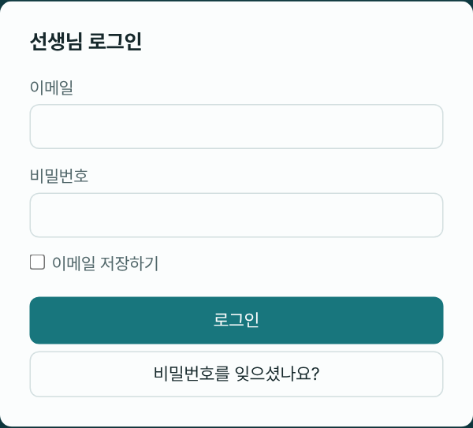
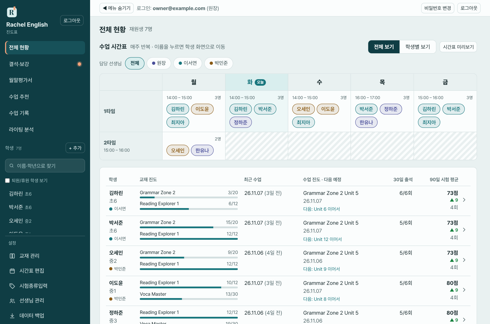

# 1. 시작하기

## 접속하기

- 브라우저(크롬·사파리 등)에서 앱 주소를 열면 **선생님 로그인** 화면이 나옵니다.
- **이메일**과 **비밀번호**를 입력하고 **로그인**을 누릅니다.
- "이메일 저장하기"를 체크하면 다음에 이메일 입력을 생략할 수 있습니다. 비밀번호는 저장하지 않습니다.
- 비밀번호가 기억나지 않으면 **비밀번호를 잊으셨나요?** 를 눌러 이메일을 입력합니다. 비밀번호를 새로 정하는 메일이 옵니다.

## 휴대폰에 앱처럼 설치하기

주소창 없이 앱처럼 쓸 수 있습니다.

- **아이폰(사파리)**: 공유 버튼 → **홈 화면에 추가**
- **안드로이드(크롬)**: 메뉴(⋮) → **홈 화면에 추가** 또는 **앱 설치**

## 화면 구성

### 왼쪽 메뉴

| 위치 | 이름 | 하는 일 |
|---|---|---|
| 위쪽 | 전체 현황 | 모든 학생의 진도·출석·시험을 한 표로 보고, 수업 시간표를 확인합니다 |
| | 결석·보강 | 결석한 수업을 보강으로 채우는 일을 관리합니다. 처리할 결석이 있으면 메뉴에 **점**이 표시됩니다 |
| | 월말평가서 | 월별로 학생마다 평가서를 만들고 인쇄합니다 |
| | 수업 추천 | 학생별 다음 수업 진도 추천을 확인합니다 |
| | 수업 기록 | 날짜를 고르고 그날 수업한 학생들의 기록을 한 번에 입력합니다 |
| | 라이팅 분석 | 학생이 쓴 영어 글의 첨삭 결과를 월별로 모아 봅니다 |
| 가운데 | 학생 | **+ 추가**로 학생을 등록하고, 검색칸으로 찾고, 이름을 눌러 학생 화면으로 이동합니다 |
| 아래쪽 | 설정 | 교재 관리 / 시간표 편집 / 시험종류입력 / 선생님 관리 / 데이터 백업 |

- 학생 목록 위의 **검색칸**에 이름이나 학년을 넣으면 목록이 걸러집니다. 한 글자만 넣어도 되고, "ㅎㄹ" 같은 초성으로도 찾습니다. **Enter**를 누르면 맨 위 학생 화면이 열리고, **Esc** 또는 ✕로 지웁니다.
- **퇴원/휴원 학생 보기**를 체크하면 퇴원한 학생도 목록에 나옵니다(흐리게 표시).

### 위쪽 줄

- **메뉴 / ◀ 메뉴 숨기기**: 왼쪽 메뉴를 열거나 접습니다. 휴대폰에서는 `메뉴` 버튼을 눌러 엽니다.
- **로그인: 이메일 (원장)**: 지금 어떤 계정으로 들어와 있는지 보여줍니다.
- **비밀번호 변경**, **로그아웃**

## 비밀번호 바꾸기

위쪽 **비밀번호 변경**을 누르고 새 비밀번호를 입력합니다. 처음 로그인하면 바꿔 두시길 권합니다.

## 자동 로그아웃

- 30분 동안 아무 입력이 없으면 자동으로 로그아웃됩니다.
- 로그아웃 1분 전에 화면 아래에 "○○초 후 사용이 없어 자동 로그아웃됩니다"가 나옵니다. **계속 사용**을 누르면 유지됩니다.
- 작성 중이던 내용은 사라질 수 있으니, 오래 자리를 비울 때는 먼저 저장해 주세요. ([수업 기록](06-수업-기록.md)은 임시저장 기능이 있습니다.)

## 알아두면 좋은 점

- **저장해야 반영됩니다.** 입력만 하고 저장하지 않으면 다른 기기에서 보이지 않습니다.
- **여러 기기에서 같은 데이터**를 봅니다. 폰에서 입력한 것이 PC에서도 보입니다.
- 학생 정보가 들어 있으니 공용 PC에서는 사용 후 꼭 **로그아웃**하세요.
