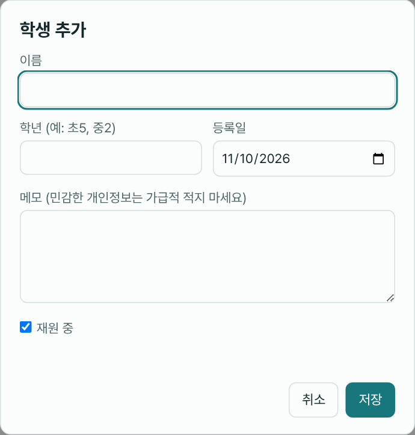

# 3. 학생 관리

## 학생 추가하기

1. 왼쪽 메뉴의 학생 제목 오른쪽 **+ 추가**를 누릅니다.
2. 입력합니다.

| 항목 | 설명 |
|---|---|
| 이름 | 필수. 최대 50자 |
| 학년 | 예: 초5, 중2. 목록에 이름 옆에 작게 표시됩니다 |
| 등록일 | 기본은 오늘. 이미 다니던 학생이면 실제 등록일로 바꿉니다 |
| 메모 | 학생 화면 맨 위에 표시됩니다. **민감한 개인정보는 가급적 적지 마세요** |
| 재원 중 | 체크되어 있으면 재원생입니다. 해제하면 퇴원/휴원으로 처리됩니다 |

3. **저장**을 누르면 학생이 만들어지고 바로 그 학생 화면(교재 진도 탭)이 열립니다.

> 선생님 계정에서 **+ 추가** 버튼이 보이지 않거나 저장되지 않으면, 선생님의 "새 학생 등록·퇴원 처리" 권한이 꺼져 있는 것입니다. ([2장](02-선생님-관리.md))

### 학생을 추가한 다음에 할 일

1. [교재를 배정](04-교재와-진도.md)합니다.
2. [시간표에 학생을 넣습니다](05-수업-시간표.md).
3. 선생님이 있다면 [담당 선생님을 정합니다](02-선생님-관리.md).

## 학생 화면 구성

왼쪽 목록에서 학생 이름을 누르면 학생 화면이 열립니다.

- 위쪽: 이름, 학년, 퇴원/휴원 표시, **정보 수정**, 메모
- 탭 5개:

| 탭 | 내용 | 설명 |
|---|---|---|
| 교재 진도 | 교재별 현재 진도 | [4장](04-교재와-진도.md) |
| 수업 기록 | 날짜별 출결·진도·숙제·메모 | [6장](06-수업-기록.md) |
| 시험·단어 | 시험 점수와 추이 | [10장](10-시험-단어.md) |
| 라이팅 | 영어 글 첨삭 | [11장](11-라이팅.md) |
| 수업 추천 | 이 학생의 추천 목록 | [7장](07-수업-추천.md) |

## 학생 정보 수정 · 퇴원 · 삭제

학생 화면 위쪽 **정보 수정**을 누릅니다.

- **이름, 학년, 등록일, 메모**를 고치고 **저장**합니다.
- **퇴원/휴원 처리**: **재원 중** 체크를 해제하고 저장합니다.
  - 퇴원 학생은 전체 현황, 시간표 배정, 수업 추천 등에서 빠집니다.
  - 기록은 그대로 남아 있고, 왼쪽의 **퇴원/휴원 학생 보기**를 체크하면 볼 수 있습니다.
  - 다시 다니게 되면 **재원 중**을 체크해 되돌립니다.
- **삭제**: 창 왼쪽 아래의 **삭제**를 누르면 **학생과 그 학생의 모든 기록**(수업·시험·진도·라이팅 등)이 지워지고 **되돌릴 수 없습니다.** 퇴원한 학생은 삭제하지 말고 퇴원 처리만 해 두는 것을 권합니다.

## 학생 찾기

- 왼쪽 목록 위 검색칸에 이름·학년을 넣습니다. (한 글자, 초성 가능)
- 결과 줄 오른쪽에 `3 / 12명`처럼 찾은 수와 전체 수가 나옵니다.
- 맞는 학생이 없으면 "'○○'와 맞는 학생이 없어요."가 나옵니다.

## 학생 목록에서 보이는 것

- 이름과 학년이 한 줄에 나오고, 지금 보고 있는 학생은 강조됩니다.
- 퇴원/휴원 학생은 흐리게 표시됩니다.
- 제목 옆 숫자는 학생 수입니다. 퇴원 학생 보기를 켜면 숫자에 마우스를 올려 재원·퇴원 인원을 볼 수 있습니다.
