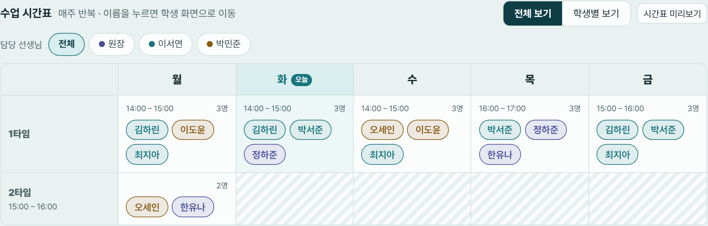
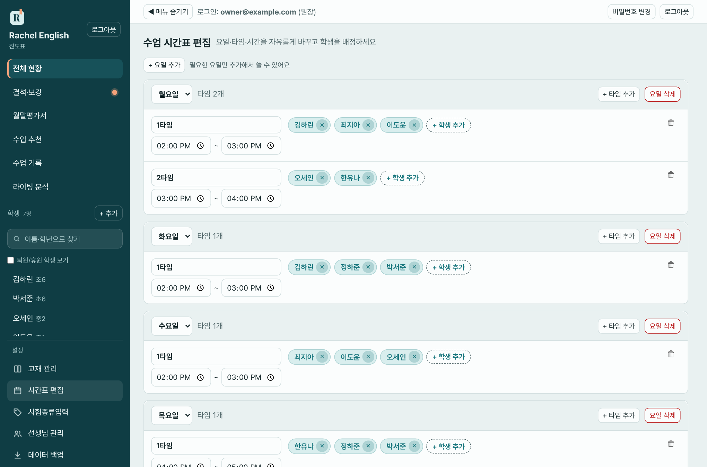

# 5. 수업 시간표

시간표는 **요일 → 타임 → 학생** 구조이고, **매주 반복**됩니다. 전체 현황 맨 위에서 확인하고, 수업 기록 화면은 이 시간표를 기준으로 그날 수업할 학생을 불러옵니다.

## 5-1. 시간표 보기

**메뉴 위치:** 왼쪽 **전체 현황** 맨 위의 "수업 시간표"

- 요일 열마다 타임이 있고, 타임 안에 학생 이름이 칩으로 나옵니다.
- **오늘 요일**은 강조됩니다.
- 이름을 누르면 그 학생 화면으로 이동합니다.
- **전체 보기 / 학생별 보기**
  - 전체 보기: 모든 학생이 보입니다.
  - 학생별 보기: 학생 한 명을 골라 그 학생의 수업 요일·시간만 봅니다. 이름 칩 또는 선택칸으로 학생을 바꿉니다.
- 원장 화면에서 **담당 선생님** 버튼(전체/원장/선생님 이름)을 누르면 그 선생님 학생만 진하게 보이고 나머지는 흐리게 보입니다. 선생님마다 다른 색 점이 붙습니다.

## 5-2. 시간표 미리보기·인쇄

시간표 위의 **시간표 미리보기** 버튼(학생별 보기에서는 "○○ 시간표 미리보기", 선생님을 고른 상태에서는 "○○ 선생님 시간표 미리보기")을 누릅니다.

- **세로 / 가로** 방향을 고를 수 있습니다.
- 세로는 수업이 있는 요일·타임만, 가로는 전체 격자로 나옵니다.
- 선생님을 고른 상태에서는 그 선생님 학생만 들어가고 제목이 "○○ 선생님 담당 수업 시간표"가 됩니다.
- 학생 한 명을 고른 상태에서는 그 학생 시간표만 나옵니다.
- **인쇄**하거나 PDF로 저장합니다.

## 5-3. 시간표 편집하기

**메뉴 위치:** 왼쪽 아래 **설정 → 시간표 편집**

| 하고 싶은 일 | 방법 |
|---|---|
| 요일 만들기 | **+ 요일 추가** |
| 요일 지우기 | 해당 요일의 **요일 삭제** |
| 타임 만들기 | 요일 안의 **+ 타임 추가** |
| 타임 이름·시간 바꾸기 | 타임 이름 칸과 시작~끝 시간 칸을 직접 고칩니다 |
| 타임 지우기 | 타임의 🗑 (타임 삭제) |
| 학생 넣기 | 타임의 **+ 학생 추가** → 학생 체크 |
| 학생 빼기 | 학생 이름 칩의 **×** |

- 학생 선택 창에서 **이미 다른 타임에 들어 있는 학생**은 이름 옆에 어느 타임인지 작게 표시됩니다. 한 학생을 여러 타임에 넣을 수도 있습니다.
- 원장은 학생 선택 창에서 **원장 학생 / 선생님별 학생**으로 묶인 목록을 봅니다.
- 다 고쳤으면 **저장**, 취소하려면 **취소**를 누릅니다. **저장해야 반영됩니다.**

### 선생님 계정의 시간표

- 모든 선생님이 **같은 요일·타임**을 공유합니다.
- 선생님 화면에는 **내 학생만** 나옵니다. 저장해도 다른 선생님 학생은 그대로 보존됩니다.
- 타임 이름·시간을 바꾸거나 타임을 추가·삭제하려면 [권한](02-선생님-관리.md)의 "타임 추가·삭제·시간 변경"이 켜져 있어야 합니다. 꺼져 있으면 내 학생을 넣고 빼는 것만 할 수 있습니다.
- 다른 선생님 학생이 들어 있는 타임은 삭제할 수 없습니다.

## 5-4. 시간표가 쓰이는 곳

- **수업 기록**: 날짜를 고르면 그 요일 타임에 배정된 학생이 자동으로 나옵니다.
- **교재 진도**: 학생의 수업 요일을 요일 선택 때 안내합니다.
