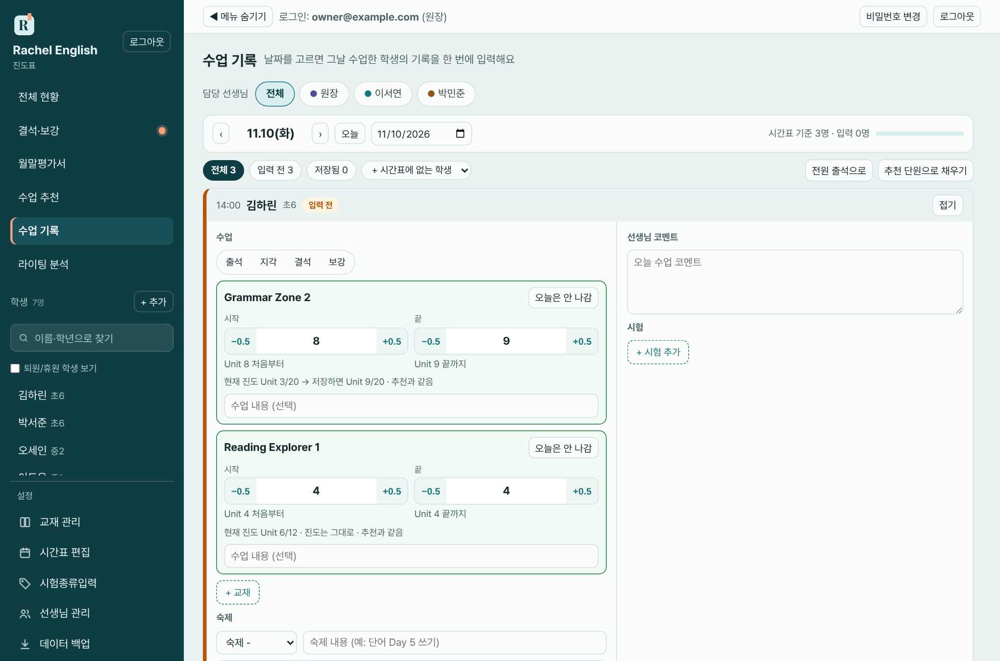
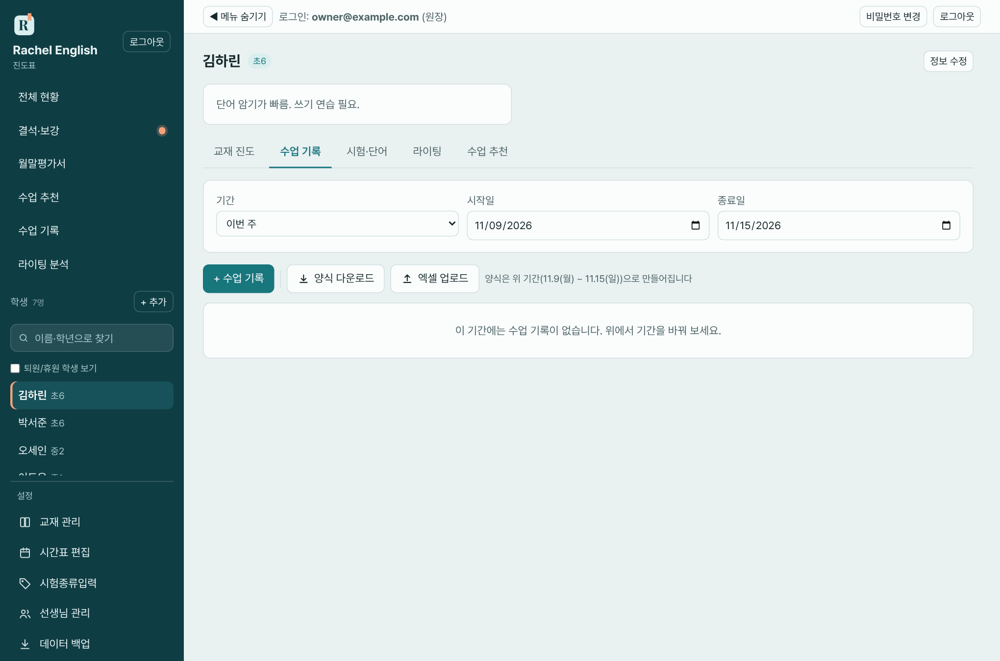

# 6. 수업 기록

수업이 끝나면 **출결·진도·숙제·코멘트·시험**을 기록합니다. 기록하는 방법은 세 가지입니다.

| 방법 | 언제 쓰나요 |
|---|---|
| **6-1. 날짜별 일괄 입력** (왼쪽 메뉴 수업 기록) | 매일 그날 수업한 학생들을 한 번에 입력 — **가장 많이 쓰는 방법** |
| 6-2. 학생 화면에서 한 건씩 입력 | 한 학생의 기록을 추가·수정·삭제할 때 |
| 6-3. 엑셀 업로드 | 지난 기록을 한꺼번에 옮겨 넣을 때 |

## 6-1. 날짜별 일괄 입력

**메뉴 위치:** 왼쪽 메뉴 **수업 기록**

### 화면 구성

1. **날짜 줄**: `‹` `›` 버튼으로 전날·다음날로 이동하고, **오늘** 버튼으로 오늘로 돌아옵니다. 날짜 칸을 눌러 달력에서 고를 수도 있습니다.
2. **걸러 보기 줄**: `전체 / 입력 전 / 저장됨` 칩에 인원이 표시됩니다. 오른쪽에는 **전원 출석으로**, **추천 단원으로 채우기** 버튼과 `+ 시간표에 없는 학생` 선택칸이 있습니다.
3. **학생 카드 목록**: 그날 시간표에 배정된 학생이 시간표 시간순으로 나옵니다.
4. **아래쪽 저장 줄**: 저장 대기 인원, **임시저장**, **전체 저장** 버튼

원장 화면에서는 맨 위에 `담당 선생님 [전체] [원장] [선생님 이름]` 버튼도 나옵니다. 선생님을 고르면 그 선생님 학생 카드만 보입니다.

### 학생 카드 입력 방법

카드 하나가 학생 한 명의 그날 기록입니다. 카드 윗줄에 시간, 이름, 학년과 **상태 표시**(입력 전 / 저장됨 등)가 나옵니다.

| 칸 | 입력 방법 |
|---|---|
| **출결** | 출석 / 지각 / 결석 / 보강 중 하나를 누릅니다 |
| **교재** | **+ 교재**를 누르면 그날 요일에 배정된 이 학생의 교재가 나옵니다. 검색해서 **추가**를 누릅니다. 교재가 여러 권이면 여러 번 추가합니다 |
| 교재별 **시작·종료 단원** | 그날 한 범위. 예: 6 ~ 7. 시작 단원은 현재 진도에서 자동으로 채워지고, 0.5 단위(예: 7.5)도 됩니다 |
| 수업 내용 | 교재별로 적는 짧은 메모 (선택) |
| **숙제** | `- / 완료 / 일부 / 미제출` 중 선택, 옆 칸에 숙제 내용 (예: 단어 Day 5 쓰기) |
| 수업 메모 | 짧은 메모 (선택) |
| **선생님 코멘트** | 오늘 수업 총평. 최대 5,000자. 월말평가서에 자동으로 모입니다 |
| **시험** | **+ 시험 추가** → 종류 선택, 시험 이름, 점수 / 만점 (백분율이 옆에 자동 표시) |

**출결별로 달라지는 점**

- **결석**: 결석 사유만 적고, 선생님 코멘트를 남길 수 있습니다. 저장하면 [결석·보강](09-결석-보강.md) 목록에 올라옵니다. 결석은 진도에 반영되지 않습니다.
- **보강**: 결석한 수업을 채우는 날입니다. 이때는 그 요일에 배정되지 않은 교재도 넣을 수 있습니다. 보강 기록을 저장하면 보강이 자동으로 **완료**됩니다.
- **지각 / 출석**: 같은 방식으로 입력합니다.

> 교재 선택 창에 "이 요일에 배정된 교재만 넣을 수 있어요. 다른 교재는 출결을 '보강'으로 바꾸세요."라고 나옵니다. 교재의 수업 요일을 바꾸려면 [4장](04-교재와-진도.md)을 보세요.

### 빠르게 입력하는 방법

- **전원 출석으로**: 아직 출결을 입력하지 않은 학생(필터로 보이는 학생)을 모두 "출석"으로 바꿉니다. 결석자만 따로 고치면 됩니다.
- **추천 단원으로 채우기**: [수업 추천](07-수업-추천.md)이 있는 학생의 교재·단원을 추천대로 채웁니다. 채울 추천이 없으면 "채울 추천 단원이 없어요"가 나옵니다.
- **+ 시간표에 없는 학생**: 시간표에 없는 날 수업한 학생(보충·추가 수업)을 그날 목록에 더합니다.
- **카드 접기/펼치기**: 카드 윗줄의 **접기 / 펼치기** 버튼으로 요약만 보이게 접었다 펼 수 있습니다.

### 저장하기

- 입력하면 **저장 대기**가 되고, 아래쪽에 "**○명**의 변경이 저장 대기 중이에요"가 나옵니다.
- **전체 저장 (○명)**을 누르면 대기 중인 카드가 모두 저장됩니다.
  - 저장하면 교재 진도가 그날의 종료 단원으로 갱신됩니다. (결석 제외)
  - 저장된 카드는 **저장됨**으로 바뀝니다. 같은 날 다시 입력해 저장하면 기존 기록이 고쳐집니다.
- **임시저장**: 입력 중에는 몇 초마다 **자동으로 임시저장**됩니다. 로그아웃되거나 창을 닫아도 다음에 열면 **"임시저장된 내용이 있어요"** 안내가 나오고, **이어서 입력** 또는 **버리기**를 고를 수 있습니다.
- 저장하지 않고 날짜를 옮기면 임시저장이 먼저 됩니다.

### 데이터 읽는 법

- 카드 상태 표시: **입력 전**(아직 기록 없음) / **저장됨**(이미 저장된 기록) / 저장 대기(수정했지만 아직 저장 안 함)
- `전체 · 입력 전 · 저장됨` 칩의 숫자로 오늘 몇 명이 남았는지 확인합니다. 위쪽 진행 표시는 입력 완료 비율입니다.
- `시간표 기준 ○명 · 입력 ○명`은 시간표에 배정된 인원과 입력한 인원입니다.

## 6-2. 학생 화면에서 한 건씩 입력

1. 학생 이름을 눌러 학생 화면을 열고 **수업 기록** 탭을 엽니다.
2. 위쪽에서 기간을 고르고(전체·이번 달 등), **+ 수업 기록**을 누릅니다.
3. 창에서 입력합니다.

| 항목 | 설명 |
|---|---|
| 날짜 | 수업한 날 |
| 출결 | 출석 / 지각 / 결석 / 보강 |
| 교재·단원 | 교재별 시작·종료 단원과 학습 내용 (여러 교재 가능) |
| 숙제 | 완료 여부와 숙제 내용 |
| 수업 메모 | 짧은 메모 |
| 선생님 코멘트 | 길게 적을 수 있음. 최대 5,000자 |
| 다음 수업 예정 진도 | 전체 현황의 "다음 예정"에 표시됩니다 |
| 저장할 때 교재 진도도 갱신 | 체크하면 종료 단원으로 진도가 올라갑니다. 결석은 제외 |

4. **저장**을 누릅니다.

기록 표는 **날짜 / 출결 / 수업 진도 / 숙제 / 메모·다음 수업** 열로 나옵니다. **행을 누르면 수정·삭제**할 수 있습니다. 최근 300건까지 표시됩니다.

## 6-3. 엑셀로 한꺼번에 올리기

지난 수업 기록이 엑셀에 있을 때 한 번에 옮길 수 있습니다.

1. 학생 화면 **수업 기록** 탭의 **양식 다운로드**를 눌러 엑셀 양식을 받습니다. (위에서 고른 기간 기준으로 만들어집니다)
2. 양식에 날짜·출결·교재·단원 등을 채웁니다.
3. **엑셀 업로드**로 파일을 올리면 미리보기 창이 나옵니다. 오류가 있는 줄이 표시됩니다.
4. 이미 기록이 있는 날은 **건너뛰기(기존 유지)** 또는 **덮어쓰기**를 고릅니다.
5. **○건 저장**을 누릅니다.

## 자주 하는 실수

- **저장하지 않고 다른 화면으로 이동**: 입력 내용은 임시저장되지만, 다른 기기에서는 **전체 저장**을 눌러야 보입니다.
- **교재가 선택 목록에 없다**: 그 학생에게 교재가 배정되어 있지 않거나, 그날 요일에 배정된 교재가 아닙니다. [4장](04-교재와-진도.md)에서 요일을 확인하세요.
- **학생이 그날 목록에 없다**: 시간표에 없는 요일입니다. `+ 시간표에 없는 학생`으로 더하세요.
- **결석인데 진도가 올랐다**: 결석은 진도에 반영되지 않습니다. 출결을 확인하세요.
